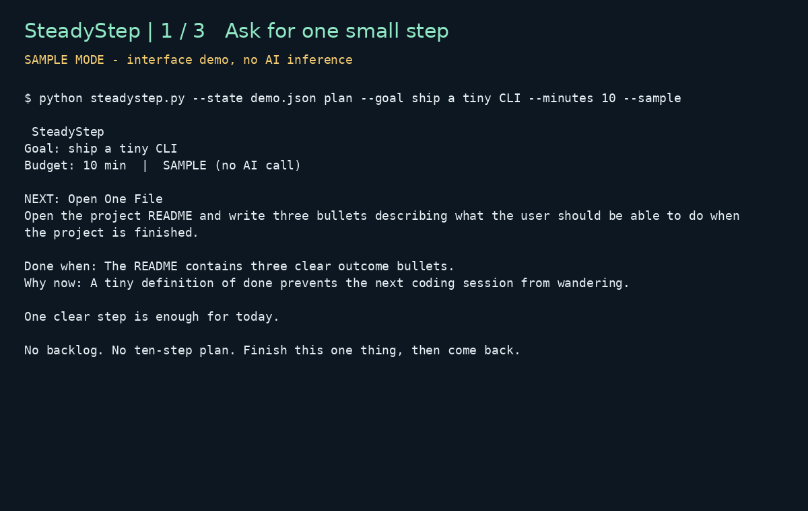

# 🦥 SteadyStep

**One small local-AI action at a time.** Built for Hacktoberfest 2026 Week 3: **Slow and Steady**.

SteadyStep is a tiny CLI that deliberately refuses to give you a giant productivity plan. Give it a goal and a time budget; a **local open-weight Gemma model** returns exactly one concrete next action. Finish it, record what happened, and only then ask for the next step.

The idea is simple: the fastest way to stop making progress is to turn every goal into a 30-item backlog.

## Why it fits “Slow and Steady”

SteadyStep keeps only a short local history of completed actions and feeds that history back to the model. Each new action builds on what actually happened instead of producing a fresh generic plan every time.

The loop is intentionally boring:

```text
set a goal → get one small step → do it → record outcome → repeat
```

No streak pressure. No infinite backlog. No cloud account.

## Open-source AI core

- **Model:** Gemma 3 (`gemma3:1b` by default)
- **Runtime:** Ollama
- **Inference:** localhost only
- **Cloud model APIs:** none
- **Application dependencies:** Python standard library only

The model is the core planning component: it uses the goal, time budget, and recent completed steps to choose the next action. `--sample` exists only to preview the interface and is clearly labelled as non-AI output.

## Quick start

1. Install Ollama.
2. Pull the model:

```bash
ollama pull gemma3:1b
```

3. Download or clone this repository and enter its directory. Python 3.10+ is required. Start with a goal:

```bash
python steadystep.py plan --goal "learn binary search trees in C" --minutes 15
```

4. When the step is finished:

```bash
python steadystep.py done --outcome "Implemented insert() and tested three nodes"
```

5. Ask for the next step:

```bash
python steadystep.py plan --minutes 15
```

Check progress any time:

```bash
python steadystep.py status
```

## Recorded interface demo



This animation renders actual CLI output from sample mode. It does not show live model inference.

## Demo without Ollama

```bash
python steadystep.py --state demo-state.json plan \
  --goal "ship a tiny CLI" --minutes 10 --sample
```

Sample output:

```text
🦥 SteadyStep
Goal: ship a tiny CLI
Budget: 10 min  •  SAMPLE (no AI call)

NEXT: Open One File
Open the project README and write three bullets describing what the user should be able to do when the project is finished.

Done when: The README contains three clear outcome bullets.
Why now: A tiny definition of done prevents the next coding session from wandering.

One clear step is enough for today.

No backlog. No ten-step plan. Finish this one thing, then come back.
```

## Local state

By default SteadyStep stores progress in:

```text
~/.steadystep/state.json
```

Only the latest six completed steps are placed into the model prompt, keeping context small and focused. State is written atomically through a temporary file so an interrupted write does not leave a half-written JSON file.

Use a separate progress file for each goal, for example `python steadystep.py --state study.json plan --goal "learn BSTs" --minutes 15`. Use that same `--state` argument for `done` and `status`.

## Validation and limitations

Nine automated tests pass locally, including mocked Ollama response parsing, pending-step reuse, and goal isolation. Live Gemma inference has not been exercised in the publishing environment. Time limits and one-action wording are model instructions, not guarantees; users should judge each suggested action.

## Safety boundary

SteadyStep is a general progress tool, not a professional advisor. The model prompt explicitly avoids medical, legal, financial, self-harm, weapons, and other high-stakes instructions and redirects those goals toward qualified help.

## Tests

```bash
python -m unittest discover -s tests -v
```

The tests cover schema validation, local persistence, pending-step reuse, prompt constraints, and bounded history.

## Why open innovation matters

A tool that remembers personal goals and progress should not require shipping that history to a hosted model. Running Gemma locally means the core loop can work on the user's own machine, without per-request API fees and without turning a private progress log into someone else's cloud data.

Open weights also make the behavior inspectable and replaceable. The prompt is visible, the runtime is swappable, and a contributor can use a different compatible Ollama model without asking permission from a proprietary service.

## Challenge window

This project was created for the Hacktoberfest 2026 Open-Source AI Challenge Week 3 (October 19–25, 2026): **Slow and Steady**.

## License

MIT
